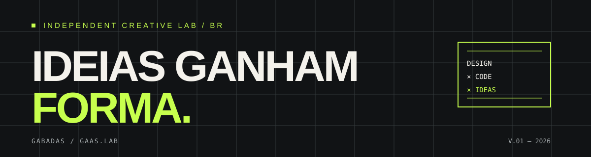

# gabadas / gaas.lab

### IDEIAS GANHAM FORMA.

Design de interfaces · Desenvolvimento web · Experimentação digital

[Projetos](#-projetos-em-destaque) · [Stack](#-ferramentas-e-tecnologias) · [Contato](#-vamos-conversar)

---

## // Sobre

Sou Gabriel, designer com interesse em desenvolvimento web e criação de produtos digitais. Gosto de conectar pensamento visual, experiência de uso e código para transformar ideias em experiências que funcionam de verdade.

Este perfil é meu laboratório: projetos, experimentos e soluções construídas entre **design × tecnologia × criatividade**.

## // Projetos em destaque

### 01. Barbearia Bravio
Sistema web para centralizar a operação de uma barbearia, com áreas de agenda, serviços, equipe e controle financeiro.

- **Foco:** produto digital, interface e experiência de uso
- **Tecnologias:** React, JavaScript, Vite, CSS, Supabase
- **Aplicação:** [barbearia-bravio.vercel.app](https://barbearia-bravio.vercel.app/)
- **Código:** [gaas-lab/barbearia-bravio](https://github.com/gaas-lab/barbearia-bravio)

### 02. ponto.
Projeto em desenvolvimento no ecossistema gaas.lab.

- **Código:** [gaas-lab/ponto.](https://github.com/gaas-lab/ponto.)

## // Ferramentas e tecnologias

## // Princípios de trabalho

- **Design com intenção:** cada escolha visual deve ajudar a experiência.
- **Código com propósito:** construir soluções úteis, não apenas telas bonitas.
- **Aprendizado contínuo:** testar, documentar, iterar e compartilhar.

## // Vamos conversar?

Quer trocar uma ideia sobre design, interfaces ou projetos digitais?

- GitHub: [@gabadas](https://github.com/gabadas)
- Instagram: [@gaasbrel](https://www.instagram.com/gaasbrel/)

---

`DESIGN × CODE × IDEAS`

Feito em ciclos de curiosidade, café e commits.

